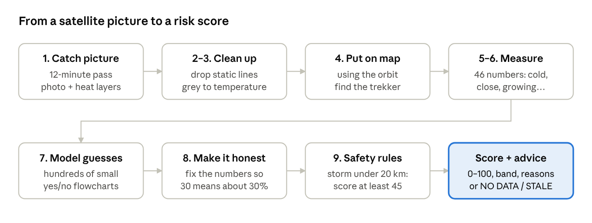

# SummitSathi Model — Interview Prep

## Start here: the idea in plain words

**The problem.** Trekkers in the mountains have no phone signal, so they can't check the weather. Storms are one of the biggest dangers up there.

**The idea.** Weather satellites fly overhead all day and broadcast cloud pictures by radio, free, to anyone. A small device with an antenna can catch those pictures. SummitSathi's model looks at the picture and answers one question:

> **"How likely is bad weather where I'm standing right now?"**

**The answer** is a number from 0 to 100, called the **Climb Risk Score**. A score of 30 means "in the past, when things looked like this, bad weather happened about 30 times out of 100". "Bad weather" means a thunderstorm, rain within 3 hours, or fog.

**The key trick: cold clouds mean storms.** The satellite has a heat camera (infrared). It measures how cold the top of each cloud is. Storm clouds grow very tall, and the higher a cloud goes, the colder its top gets. So a cloud top colder than **−40 °C** almost always means a storm cloud.

**Did it work?** I tested it on about 11,000 real satellite pictures of India from 2018–2025 and checked against what airports actually reported. It caught **7 out of 10 thunderstorms**, and it was clearly better than just guessing from "what the weather is usually like here this time of year".

**One sentence to say in the interview:** "It reads how cold and how close the storm clouds are from space, and turns that into an honest chance of bad weather for the trekker's exact spot."

## What type of model is it?

A **gradient-boosted decision tree classifier** (scikit-learn's `HistGradientBoostingClassifier`, the same family as XGBoost and LightGBM), trained on 46 physical features from the satellite image. Its output is calibrated with **isotonic regression** so the score is a true probability. Two hand-set **safety rules** are applied after the model.

## What goes in, what comes out

Think of it as a box: a satellite picture and your location go in; a risk score and advice come out.

**What goes in**

- **The satellite picture** from one pass overhead (a pass lasts about 12 minutes). It has two layers: a normal-looking photo (daytime) and a heat picture (day and night).
- **Where the satellite was** during the pass, so we know which pixel is which place on the map.
- **Your GPS position** and the time.
- **The previous picture**, if there was one in the last few hours, to see if clouds are growing.
- **What the weather is usually like** at the nearest airport in that month and at that time of day.

**What comes out**

- **A score from 0 to 100** (the chance of bad weather, as a percentage).
- **A band and simple advice**:

| Band | Score | What the screen says | How often bad weather really followed (2019 test) |
| --- | --- | --- | --- |
| Minimal | 0–10 | Conditions favourable, keep checking each pass | 3 in 100 |
| Low | 10–25 | Low risk, monitor conditions | 18 in 100 |
| Moderate | 25–45 | Proceed with caution, set a turn-around time | 32 in 100 |
| High | 45–70 | Avoid exposed ridges, consider turning back | 47 in 100 |
| Extreme | 70–100 | Do not climb, hazardous weather likely | 74 in 100 |

- **The reasons**, in plain words, e.g. "Storm cloud 18 km away" or "Cloud tops getting colder fast, storm growing".
- **A warning if the data is old or missing.** It says *Stale* if the last picture is over 3 hours old and *No data* if it couldn't see your spot. It never just says "safe".

## How it works, step by step

The top row of the picture is about **getting a clean, readable picture**. The bottom row is about **turning that picture into a score**.

### Part 1: get a clean picture

1. **Catch the picture.** The satellite sends its picture line by line, 2 lines a second, for about 12 minutes.
2. **Clean it up.** Radio signals pick up static. Each line has a known "beep" pattern at its start, so I check it and throw away lines that are just noise.
3. **Turn brightness into temperature.** The raw picture is just shades of grey. The satellite also sends reference strips (known grey levels and a known warm object inside the camera). Comparing against those turns each grey pixel into a real **temperature in kelvin**. (Kelvin = °C + 273, so −40 °C = 233 K.)
4. **Put it on the map.** From the satellite's orbit I know where it was every half-second, so I can work out which place on Earth each pixel shows. My first version got this wrong and stretched India 40% too wide; I caught it by laying real coastlines over the picture.

### Part 2: turn the picture into a score

5. **Look around the trekker.** Cut out a square about 60 km wide centred on their position. Also search the whole picture (up to 500 km away) for the nearest storm cloud.
6. **Take 46 measurements.** These answer six simple questions:

| Question | What it measures | Why it matters |
| --- | --- | --- |
| How cold are the clouds overhead? | Coldest cloud top; share of cloud colder than 0 °C, −20 °C, −40 °C | Colder top = taller cloud = more likely a storm |
| How close is the nearest storm? | Distance to the nearest cloud colder than −40 °C | A storm 10 km away matters more than one 200 km away |
| How violent is it? | "Overshooting tops": small spots much colder than the cloud around them | These are strong updrafts punching through, a sign of a severe storm |
| Is it thick or thin? (daytime) | How bright the cloud looks in the normal photo | Thick storm cloud is cold *and* bright; thin wispy cloud is cold but dim |
| Is there fog? (night) | Difference between two heat channels | Fog shows up as a small temperature gap between them |
| Is it growing? | How much colder the cloud tops got since the last picture | Tops cooling fast = storm building right now |

Plus the **time of day, month**, and **what the weather is usually like** at the nearest airport.

7. **Ask the trained model.** The model is a **gradient-boosted decision tree** model. Think of a decision tree as a flowchart of yes/no questions: "Is the coldest cloud below −40 °C? Is it within 20 km?" The model is hundreds of small flowcharts. Each new one focuses on the mistakes the earlier ones made, and their answers are added up into a first guess.
8. **Make the number honest (calibration).** The first guess ranks cases well, but its numbers aren't true percentages. A correction step (isotonic regression) adjusts them using a separate year of data, so that a score of 30 really means about 30 in 100.
9. **Apply safety rules.** If there is storm cloud within 20 km, the score can't go below 45. If there's a violent storm top within 50 km, it can't go below 48. Those numbers came from data: that's how often bad weather followed in those situations.

**Which measurements matter most?** For thunderstorms: the local storm history, violent storm tops within 100 km, and the coldest cloud within 100 km. For rain: how much cold cloud is within 100 km. For fog: the local fog history.

## How I know it works

I tested the model like an exam: it learned from some years, then was tested on a year it had never seen.

**The data**

- **Pictures:** real recordings of NOAA weather satellites over India, 2018–2025, saved online by volunteer radio stations (SatNOGS). Many recordings were just static, so I filtered those out. 677 passes were usable.
- **The "right answers":** reports from 44 airports. Airports log the weather every hour (these reports are called METAR), so I could check: did a thunderstorm, rain or fog actually happen?
- **In total:** 11,156 cases, where one case = one picture checked at one airport.

**The fair test**

- **Why not just shuffle the data?** Weather on Monday is like weather on Tuesday. If you shuffle, the model sees part of the same storm in training and in the exam, and looks better than it is.
- **So I hold out a whole year.** The model learned from 2020–2025 (5,808 cases) and was tested on **2019** (2,860 cases) that it never saw.
- **2020 was kept for tuning** the settings and the "make it honest" step, so the test year was never used to tweak anything.

**The comparison.** To beat: "what usually happens here". For example, if this airport has had a thunderstorm on 25% of July afternoons, that guess says 25%. If the satellite can't beat that, it adds nothing.

**Results on 2019**

| Bad weather | SummitSathi score | "What usually happens" score | Caught at safety setting |
| --- | --- | --- | --- |
| Thunderstorm now | 0.90 | 0.81 | 70% (192 of 273) |
| Rain in the next 3 hours | 0.88 | 0.68 | 69% |
| Rain now | 0.88 | 0.69 | 83% |
| Fog now | 0.98 | 0.99 | 86% |

**What the scores mean (AUC).** Pick one case where a storm happened and one where it didn't. AUC is how often the model gives the storm case the higher risk. 0.5 = coin toss, 1.0 = perfect. It is **not** "90% accurate".

**Safety setting.** I set the alarm sensitive enough to catch at least about 8 in 10 storms in the tuning year. The cost is more false alarms: when it warns of a thunderstorm, it's right about 4 times in 10. For a trekker, a false alarm is better than a missed storm.

**Fog** is the one place it doesn't beat history, because fog is so seasonal that history alone is almost perfect.

## Why it's built this way

The model went through three versions. Each time, testing on real data showed what was wrong.

| Version | What it did | What went wrong or right |
| --- | --- | --- |
| v1 | Simple fixed rules on how bright the pixels are | Caught **0 of 37** thunderstorms. Brightness isn't temperature |
| v2 | Proper temperatures + a simple statistical model | No better than "what usually happens here" |
| v3 (final) | 46 measurements + decision-tree model + honesty step + safety rules | Clearly better: 0.90 vs 0.81 for thunderstorms |

**Why decision trees and not AI image recognition (deep learning)?** Deep learning needs huge amounts of data; I had about 6,000 training cases. Decision trees work well on small tables of numbers, cope with missing data (no normal photo at night), and run fast on a small Raspberry Pi computer.

**Why measure 46 things instead of feeding in the whole picture?** Each measurement means something physical ("storm 18 km away"), so the device can show the trekker *why* the score is high.

**Why the "make it honest" step?** Without it, the model is good at saying which case is riskier, but its numbers aren't true percentages. With it, 30 means about 30 in 100.

**Why safety rules on top?** For a trekker, missing a storm is much worse than a false alarm. So a nearby storm always pushes the score up to at least "High".

**Limitations to state honestly**

- **About one look every 6 hours.** A storm that forms between passes can be missed.
- **Truth is a point; the box is about 60 km.** METAR is reported at one airport. Mountain trek sites use the nearest airport (Leh, Kullu, Shimla).
- **Black body assumed at 290 K**, not read from the PRT wedges, so absolute temperatures may be off by a few K. Learned thresholds absorb this.
- **Uneven data:** clean passes cluster in 2019–2021; 2022–25 images are mostly too noisy (that group's AUC drops to about 0.76–0.85 on 369 cases).
- **Mountain airports** have only about 2 years of METAR, so mountain-specific results have wide error bars.
- **Fog** relies on the 3B channel and only works at night; local history alone already scores 0.99 on fog.
- **The device now targets Meteor-M.** NOAA APT broadcasts ended in 2025, so the models need retraining on Meteor-M LRPT images. The method is validated; the Meteor version is not yet.

## Likely questions and simple answers

**What does the model predict?** The chance (0–100) that a thunderstorm, rain within 3 hours, or fog happens where the trekker is.

**Why do cold clouds mean storms?** Storm clouds grow very tall, and the higher a cloud top is, the colder it is. Below −40 °C means a tall storm cloud.

**Why not use AI image recognition?** Not enough data for that (about 6,000 cases), and simple measurements let the device explain its reasons.

**How do you know it isn't just memorising?** It was tested on a whole year (2019) it never saw during training.

**Is 0.90 the same as 90% accurate?** No. It's a ranking score. The simple version: it caught 7 out of 10 thunderstorms in testing.

**Isn't it just learning the season?** No. Using only the satellite measurements, with no weather history, it still scores 0.88 on thunderstorms. History alone scores 0.81.

**Why so many false alarms for rain?** Rain is rare (about 3–4 in 100 cases), and the airport is one point in a 60 km square. I chose to catch more rain and accept more false alarms.

**What if there's no satellite picture?** It says "No data" or "Stale". It never shows a low score by default.

**What was the hardest part?** Real data is messy. Many recordings were static, my first map was 40% too wide, and my first version caught zero thunderstorms. Each fix came from checking against real airport reports.

**Does it work on the new satellites (Meteor-M)?** The method is proven on NOAA data. The NOAA satellites stopped broadcasting in 2025, so the next step is to retrain the model on Meteor-M pictures.

**What would you do next?** Retrain on Meteor-M, test it on real Himalayan treks, and fix the small known errors (like the assumed camera temperature).

**Numbers to remember:** 46 measurements · 11,156 cases · 44 airports · tested on 2,860 cases from 2019 · 0.90 vs 0.81 for thunderstorms · 7 in 10 thunderstorms caught · −40 °C storm line · Minimal band: 3 in 100 had bad weather; Extreme: 74 in 100.

## Jargon cheat sheet

| Term | Plain meaning |
| --- | --- |
| APT | The simple radio format older NOAA satellites used to send pictures |
| Brightness temperature | The temperature the heat camera "sees" for a pixel, e.g. a cloud top |
| Kelvin (K) | Temperature scale: °C + 273. 233 K = −40 °C |
| TLE / SGP4 | The orbit description and the formula that say where the satellite is at any moment |
| Georeferencing | Working out which place on Earth each pixel shows |
| Overshooting top | A small, extra-cold bump on a storm cloud from a very strong updraft |
| METAR | Hourly weather report that every airport publishes |
| Climatology / local history | "What usually happens here at this time of year and day" |
| Gradient-boosted trees | Many small yes/no flowcharts, each fixing the last ones' mistakes, added together |
| Calibration (isotonic regression) | Adjusting the model's output so 30 really means 30 in 100 |
| AUC | How often a real storm gets a higher score than a calm case. 0.5 = coin toss, 1 = perfect |
| Precision / recall | Recall: share of storms caught. Precision: share of warnings that were right |
| Leave-one-year-out | Hide one year, train on the rest, test on the hidden year |
| Brier score | Average error of the predicted chances; lower is better |
